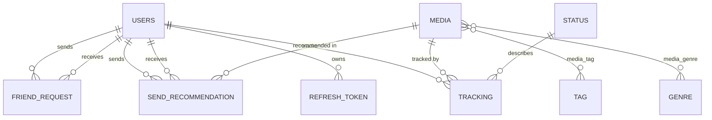

# ShelfLog (In Progress)

> **Formerly "AnimeTracker."** I renamed it because the old name left out manga and light novels.

A full-stack app for tracking **anime, manga, and light novels** in one place: follow your progress, rate titles, get recommendations based on what you've actually rated, and (planned) send a specific title to a friend. This repository is the **backend REST API**. A web frontend and a mobile app come later and will use this same API.

---

## Table of contents

1. [What it is and why I built it](#1-what-it-is-and-why-i-built-it)
2. [Current status](#2-current-status)
3. [Tech stack](#3-tech-stack)
4. [Architecture](#4-architecture)
5. [Scoping and build order](#5-scoping-and-build-order)
6. [Data model](#6-data-model)
7. [API reference](#7-api-reference)
8. [Design decisions and why](#8-design-decisions-and-why)
9. [Problems I hit and how I fixed them](#9-problems-i-hit-and-how-i-fixed-them)
10. [Security notes](#10-security-notes)
11. [Running it locally](#11-running-it-locally)
12. [Trying the API](#12-trying-the-api)
13. [Known limitations](#13-known-limitations)
14. [Roadmap](#14-roadmap)
15. [How I built it and what I learned](#15-how-i-built-it-and-what-i-learned)

---

## 1. What it is and why I built it

### The app

Anime, manga, and light novels each live in separate apps and sites today, and recommending one to a friend means hunting for the exact title again. ShelfLog treats all three as one catalog. A user can:

- Browse and search a catalog of popular titles, filtered by name, format, genre, or tag
- Track progress on a title (episode, chapter, or volume) and give it a status
- Rate titles on a 1-10 scale
- (Planned) Get recommendations computed from their own ratings and the genres and tags they like
- (Planned) Add friends and send a specific title to a friend with a note

### Why I built it

This project is about more than writing code. I'm using it to learn the steps of the software development lifecycle (requirements, design, implementation, testing, deployment, and maintenance) and, just as importantly, **why** things are built the way they are: why the schema looks the way it does, why auth works the way it does, and what tradeoff each decision carried. Every major decision in this README comes with the reasoning behind it.

---

## 2. Current status

| Area | Status |
|---|---|
| Database schema (all 9 entities) | Done |
| Auth: register, login, refresh, logout | Done and tested |
| JWT filter and default-deny security | Done and tested |
| Catalog import from AniList | Done (2,738 titles imported) |
| Catalog endpoints (`GET /media`, `GET /media/{id}`) | Done and tested |
| Tracking: start (`POST /media/{id}/tracking`) | Done and tested |
| Tracking: update, delete, list | In progress |
| Recommendations | Not started |
| Friend requests | Not started |
| Send a recommendation to a friend | Not started |
| Weekly scheduled re-import | Designed, not wired up |
| Web frontend | Not started |
| Mobile app | Not started (phase 2) |
| Deployment (Oracle Cloud) | Not started |

---

## 3. Tech stack

| Layer | Choice | Why |
|---|---|---|
| Language | **Java 25 (LTS)** | I already know Java, so I could focus on learning the framework. An LTS release gets years of security updates. |
| Framework | **Spring Boot 4.1.1** (Web, Data JPA, Security, Validation) | It's a very popular tool. |
| Build tool | **Maven** (`./mvnw`) | It's easy to learn and simple for beginners. |
| Database | **PostgreSQL on Neon** (free tier) | Free, no expiry, and I'd used it before. |
| Persistence | **Spring Data JPA / Hibernate 7** | See below. |
| Catalog data | **AniList GraphQL API**, called with Spring's `RestClient` | See [section 8.7](#87-how-the-catalog-is-populated). |
| Auth | **JWT** (jjwt 0.12.6) with rotating refresh tokens, bcrypt for passwords | See [section 8.3](#83-authentication). |
| Planned hosting | **Oracle Cloud "Always Free"** | Chosen because it's permanently free, unlike most free tiers. |
| Web frontend | **React** | Planned. |
| Mobile | Not decided | I need to research the options. |

### Why JPA/Hibernate instead of raw JDBC

In an earlier console project I wrote JDBC by hand: `PreparedStatement`s, mapping each `ResultSet` column to a field, and every `INSERT`/`UPDATE`/`SELECT` as a string. That taught me what happens underneath. JPA sits on the same mechanism and automates the repetitive parts: I define a class once and Hibernate generates the table and the CRUD SQL. The tradeoff is less direct control and some "magic" that can be hard to debug. Knowing both the abstraction and what it hides is a stronger position than knowing only one.

---

## 4. Architecture

**API-first.** The backend is designed independently of any frontend. The web app and the future mobile app are just two clients of the same API.

- The web version can be finished and demoed even if mobile never happens, and mobile later becomes an additive build, not a blocker.
- Nothing in the backend can assume it's talking to a browser. That directly drove the auth decisions (headers instead of cookies, stateless tokens).

### Request flow

```
Client
  -> JwtAuthFilter       (who are you? reads the Bearer token, records the user)
  -> SecurityConfig      (are you allowed in? public vs protected rules)
  -> Controller          (HTTP only: read the request, return the response)
  -> Service             (business logic)
  -> Repository          (database access via Spring Data JPA)
  -> PostgreSQL (Neon)
```

Each layer has one job. Controllers never contain business rules, and entities are never returned directly to clients (see [DTOs](#84-dtos-everywhere)).

### Project structure

```
src/main/java/com/keillen/ShelfLog/
├── clients/        AniListClient: outgoing calls to AniList
├── config/         SecurityConfig, StatusSeeder, ImportRunner
├── controllers/    AuthController, MediaController, TrackingController
├── dto/            Request and response records (RegisterRequest, MediaSummary, TrackingResponse, ...)
├── entities/       JPA entities and enums (User, Media, Tracking, TrackingId, Format, ...)
├── repositories/   One Spring Data interface per entity
├── security/       JwtService, JwtAuthFilter
└── services/       AuthService, MediaService, MediaImportService, TrackingService
```

Packages are created only when first needed. I didn't scaffold empty ones up front.

### 4.1 Spring annotations used in this project

An annotation is a label starting with `@` that you put on a class. Spring reads these labels to decide what to create and how to wire it together. For each marked class, Spring creates one shared object (called a **bean**) and hands it to any class that asks for it in its constructor. This is called dependency injection.

**`@SpringBootApplication`**

```java
@SpringBootApplication
```

This goes on the main class (the one with the `main` method) and is the starting point: it tells Spring "this is a Spring Boot app, start here." It's a bundle of three annotations:

- `@Configuration`: this class may define beans.
- `@EnableAutoConfiguration`: Spring sets things up automatically based on what's in `pom.xml`. For example, it sees the Postgres driver and JPA and configures the database connection.
- `@ComponentScan`: Spring searches this class's package and every sub-package for annotated classes. That's why the main class must sit in the top package. Classes outside it are never found.

**`@Component`**

```java
@Component
```

The general-purpose label: "Spring, create and manage one object of this class." It's used for classes that don't fit a more specific role. In this project that's `AniListClient`, `JwtService`, `JwtAuthFilter`, `StatusSeeder`, and `ImportRunner`.

**`@Service`**

```java
@Service
```

A `@Component` with a more descriptive name. It behaves the same, but it tells the reader "this class holds business logic." It's used on `AuthService`, `MediaService`, `MediaImportService`, and `TrackingService`.

**`@RestController`**

```java
@RestController
```

Marks a class that answers web requests and returns data (JSON) instead of a web page. Each method's return value is converted to JSON automatically. Mapping annotations like `@PostMapping("/login")` say which URL and HTTP method each method answers. It's used on `AuthController`, `MediaController`, and `TrackingController`.

**`@Configuration`**

```java
@Configuration
```

Marks a class whose job is to set things up. It contains methods marked `@Bean`, and whatever each method returns becomes a bean that Spring manages. In this project, `SecurityConfig` uses it to define the security rules and the `BCryptPasswordEncoder`. It's the right tool when the object comes from a library: you can't put `@Component` on BCrypt's own class, so you write a `@Bean` method that creates it.

**How they fit together:** `@SpringBootApplication` scans for the other labels, creates a bean for each class it finds, and passes those beans into each other's constructors. `@Service` and `@RestController` are specialized versions of `@Component`, and `@Configuration` is one too.

---

## 5. Scoping and build order

Scoping was the first real design discussion, and my thinking changed during it.

### The features on the table

Four feature areas: progress tracking, ratings, a recommendation engine, and social features (friends, sending titles to friends).

### My first answer, and why it didn't hold up

My first instinct was to keep **friends and recommendations** in v1, since they're the point of the app, and push **tracking and ratings** to v2. Pressure-testing that exposed a contradiction. A recommendation engine runs on data (genres, tags, history), and with no tracking and no ratings there is no history to recommend from. The "v2" features were actually **dependencies** of the "v1" core, so the v1/v2 split dissolved. What I needed was a dependency-ordered build sequence.

### Recommendation approach

| Technique | Verdict |
|---|---|
| Rule-based filtering ("shounen and action, not yet tracked") | Start here. It's basically a smart query. |
| Content-based filtering (compare the tag and genre vectors of titles I rated highly against titles I haven't seen) | Layer on top once ratings flow. |
| Collaborative filtering ("people like you liked X") | Needs many users and lots of ratings, or it's noise. |
| ML approaches | Need real data volume. |

As a solo developer who will be the only user for a while, collaborative filtering and ML would run on data that doesn't exist.

### Friends: from "the point of the app" to "built last"

Friends started as the centerpiece and ended up last in the build order. A friends feature on top of an app that doesn't work yet is worthless. Everything else has to function first, so friends is additive to a working core, not load-bearing for it.

### Final build order

```
users and auth -> catalog browsing -> tracking (ratings included)
               -> recommendations (live query) -> friend requests -> send a recommendation
```

Each step depends only on the ones before it.

---

## 6. Data model



| Table | Purpose and key points |
|---|---|
| `users` | `username` (unique), bcrypt `password`, `email` (unique), `avatar_url`, `bio`, `created` (date) |
| `media` | One anime, manga, or light novel: `title`, `format` enum, `description` (TEXT), `image_url`, `ref_id`, `source`, `refreshed_date`, `api_rating` (0-100, stored raw) |
| `genre`, `tag` | Unique names, linked to media through `media_genre` and `media_tag` |
| `status` | Lookup table seeded at startup: `in_progress`, `completed`, `dropped`, `plan_to_start`, `waiting` |
| `tracking` | One row per (user, media) pair with a composite primary key. Holds `status`, `current_ep_page`, and `user_rating` (1-100 internally, 1-10 in the API) |
| `refresh_token` | Server-side refresh tokens, so logout can actually revoke them |
| `friend_request` | `sender`, `receiver`, `status` (PENDING / ACCEPTED / DENIED), `created`, unique per (sender, receiver) |
| `send_recommendation` | A title sent from one user to another: `sender`, `receiver`, `media`, optional `note`, `seen` flag |

---

## 7. API reference

Everything is JSON. Protected endpoints need `Authorization: Bearer <accessToken>`.

In every protected endpoint, **the user ID comes from the verified token, never from the URL or request body.**

### Auth (public)

| Method | Path | Body | Result |
|---|---|---|---|
| POST | `/register` | `username` (3-30), `password` (8-72), `email` | `{accessToken, refreshToken}`. 409 if the username or email is taken. |
| POST | `/login` | `username`, `password` | `{accessToken, refreshToken}`. 401 `Invalid username or password` for any failure. |
| POST | `/refresh` | `refreshToken` | A new pair. The old refresh token is revoked (rotation). 401 if unknown, revoked, or expired. |
| POST | `/logout` | `refreshToken` | 204 always, even for an unknown token. |

### Catalog (public)

| Method | Path | Result |
|---|---|---|
| GET | `/media/{id}` | Full detail: description, genre and tag names, rating on a 1-10 scale. 404 if missing. |
| GET | `/media?name=&format=&genre=&tag=&page=&limit=` | A page of summaries plus `totalResults`, `totalPages`, `currentPage`. Pages start at 1, the default limit is 30, the maximum is 50, and results are sorted by rating. An invalid `format` gives 400. |

### Tracking (protected)

| Method | Path | Result |
|---|---|---|
| POST | `/media/{id}/tracking` | **Built.** Starts tracking with status `plan_to_start` and returns the row. If the user is already tracking the title, it returns the existing row unchanged. 404 if the media doesn't exist, 401 without a token. |

Example response:

```json
{
  "mediaId": 1,
  "title": "Shingeki no Kyojin",
  "format": "ANIME",
  "status": "plan_to_start",
  "currentEpPage": null,
  "userRating": null
}
```

### Planned (protected)

- `PATCH /media/{id}/tracking`: update any subset of status, progress, and rating
- `DELETE /media/{id}/tracking`: remove the row entirely (different from the `dropped` status), returns 204
- `GET /my-tracking?status=&format=&page=&limit=`
- `GET /recommendations?media_id=&genre=&tag=`: with no parameters, automatic mode from the user's highly rated titles. With parameters, seeded around that title, genre, or tag. With no history, fall back to top-rated titles.
- `POST /friend-requests/{receiver_id}`, `PATCH /friend-requests/{id}` (only the receiver can act), `GET /friend-requests?status=pending|accepted`
- `POST /friend-requests/{receiver_id}/recommendations`, `GET /recommendations/received?seen=`, `PATCH /recommendations/{id}` (only the receiver can call it)

---

## 8. Design decisions and why

### 8.1 AniList as the data source, and what to store

**AniList vs. Jikan.** AniList covers anime, manga, and light novels in one catalog, returns genres and tags natively, and needs no API key. Jikan wraps MyAnimeList and doesn't treat light novels as a first-class category.

**Store a copy or just a reference?** My first answer was "store a copy," which goes stale (episode counts and airing status change). I then overcorrected to "just reference it and fetch live," which fails too: recommendation queries like "titles tagged isekai that this user hasn't tracked" can't run if the tags only exist on AniList's servers, and external APIs have rate limits. The resolution is a split by volatility:

| Stored locally (queries depend on it) | Fetched live (changes on its own) |
|---|---|
| Title, genres, tags, description, format, cover image link | Airing status, episode count |

**`ref_id`, never the title, is the lookup key.** Titles exist in English, Japanese, and romanized forms, and spelling differences break exact matches. An ID is the same idea as a primary key.

**Images: store the link, not the file.** Storing image files would make me an unpaid image host and eat storage. The tradeoff is that a link can break if AniList moves an image.

### 8.2 Database choices

- **`ddl-auto=update`.** Hibernate creates tables from the entity classes. I confirmed by running the app twice that it does not wipe data. It also doesn't *change* an existing column's type, so a type change means dropping that table.
- **Genres and tags as `@ManyToMany` with `@JoinTable`.** Those join tables have no columns beyond the two foreign keys, so Hibernate can manage them invisibly. Genre and tag stay separate tables, because merging them would force nulls and imply a pairing that doesn't exist.
- **`tracking` as a manual entity with a composite key (`@EmbeddedId`).** Unlike the join tables, it carries real data (status, progress, rating). One row is identified by the (user, media) pair, because a single-column key would limit each user to one tracked title. `@MapsId` makes the `user` and `media` relationships *be* the two halves of the key. The key class needs `equals` and `hashCode`, because Java's default compares memory addresses, and Hibernate needs "same user and same media" to mean "same row."
- **`status` is a lookup table, but `format` and friend request status are enums.** I reasoned about each separately:
  - Tracking statuses are likely to grow (a "rewatching" status, for example). A lookup table means adding a row, not a migration.
  - Format and friend request status are closed sets, so enums stored as strings fit. (I use `@Enumerated(EnumType.STRING)`, because the default stores the enum's position and silently breaks if values are reordered.)
- **One `in_progress` status for both watching and reading.** The frontend picks "Watching" or "Reading" from `media.format`. Two statuses would let a bug save "reading" on an anime.
- **One `current_ep_page` column** instead of one per format. It means episode, chapter, or volume depending on the format, decided at display time. It's an integer, not text, because text sorts `"9"` after `"10"`.
- **`ref_id` plus `source` on media.** I added `source` after testing showed a problem: AniList numbers anime and manga separately, so the same `ref_id` can belong to two different titles, and importing one would overwrite the other. `source` (`anilist-anime`, `anilist-manga`, `anilist-novel`) tells them apart, and lookups use `findByRefIdAndSource`. After adding it, the overwriting stopped.
- **A simplified 3-value `Format` enum** (ANIME, MANGA, LIGHT_NOVEL) instead of AniList's ten release formats (TV, MOVIE, OVA, and so on), because those describe how a title was released, not the category my app needs. The translation lives in its own small method.
- **Types chosen on purpose.** `Integer` ids (so they can be null before saving). `LocalDate` for the created date, but `LocalDateTime` for token expiry, since a 15-minute token can't be judged with a date. Primitive `boolean` for `revoked` and `seen`, because there's no third state and `null` would cause `NullPointerException`s.
- **Never `unique` on a password column.** bcrypt salts every hash, so two identical passwords never match, and the constraint would also leak who shares a password.

### 8.3 Authentication

- **Hash, don't encrypt.** A password check never needs to recover the original, so a one-way hash is the right tool. bcrypt generates a random salt per password and embeds it in the hash string, so one column holds everything needed to verify. Passwords are capped at 72 characters because bcrypt ignores everything after that.
- **JWT, not sessions.** Multiple independent clients (web now, mobile later) shouldn't share server-side session state, and Oracle's free tier is memory-constrained. Verifying a JWT needs no stored state per request.
- **Token in the `Authorization: Bearer` header, not cookies.** Cookies are browser-specific. This also means CSRF protection (which exists because browsers send cookies automatically) isn't needed, so it's disabled.
- **The JWT payload is only the user ID and an expiry.** A JWT is signed, not encrypted, so anyone holding it can read it. A username or email would leak on every request and could go stale.
- **Two tokens.** The access token lasts 15 minutes. It can't be revoked early, so a short life limits the damage of a stolen one. The refresh token lasts 7 days, is a random UUID, and is stored server-side so it can be revoked. Both lifetimes are configuration values, not magic numbers in code.
- **Not a session in disguise.** A session is checked on every request. The refresh token table is only touched on `/refresh` and `/logout`.
- **The client sends the refresh token, not a user ID, to `/refresh`.** User IDs are guessable auto-increment integers. A refresh token is a long random string only that client was given.
- **Rotation on refresh.** Each `/refresh` revokes the old refresh token and issues a new one, so a stolen refresh token only works until the real client refreshes.
- **Multiple devices work.** Each login creates a new refresh token row, and logout revokes only the row sent.
- **Same error for a wrong username and a wrong password**, so attackers can't discover which usernames exist.
- **Timing doesn't leak usernames either.** If the username doesn't exist, the code still runs a bcrypt comparison against a startup-generated dummy hash, so a missing user isn't instantly distinguishable from a wrong password.
- **Logout always returns 204**, even for an unknown token, so token guessing reveals nothing.
- **Secrets live in environment variables.** `application.properties` contains only `${DB_PASSWORD}` and `${JWT_SECRET}` placeholders, so it's safe to commit. There are deliberately **no defaults**, so a missing secret fails loudly at startup instead of silently running with something guessable.

### 8.4 DTOs everywhere

Entities never leave the service layer.

- **Response DTOs** prevent leaking fields I never meant to send (the password hash, the email) and prevent infinite JSON loops (`Media` has genres, and each `Genre` points back to its media).
- **Request DTOs** prevent *mass assignment*. If a request body were a `User` entity, a client could set `id` or `created`.
- **Records** are used for all of them: immutable, no boilerplate, one per file.
- **Validation** (`@NotBlank`, `@Size`, `@Email`) applies to request DTOs only.
- **List and detail are different DTOs.** A list of 30 items leaves out the long description, genres, and tags.
- **Responses hide internals.** `TrackingResponse` returns the status as a plain name (`"plan_to_start"`), not the `Status` entity, and the rating on the API's 1-10 scale.

### 8.5 Security rules

- **The filter and the rules have separate jobs.** `JwtAuthFilter` only answers "who are you?" It records a valid token's user and otherwise lets the request through. `SecurityConfig` decides "are you allowed in?"
- **Default-deny.** A short list of public endpoints is permitted, and everything else requires authentication. Forgetting to list a new endpoint fails safe.
- **A bad or expired access token is ignored by the filter, not rejected.** Otherwise a client with an expired token couldn't call `/refresh`. Protected endpoints then answer 401 themselves, which is the signal clients use to go refresh.
- **Business logic lives in services, not controllers**, so it can be reused and tested without HTTP.
- **`@Transactional`** on multi-step writes (`register`, `login`, `refresh`, and tracking), so related writes succeed or roll back together.

### 8.6 Ratings: three different numbers

1. **The user's personal rating** (`tracking.user_rating`).
2. **AniList's community score** (`media.api_rating`, 0-100), stored raw.
3. **The app's average user rating**, computed live with `AVG` and **not stored**, so it can never go stale. At this scale the cost is negligible. If it ever mattered, the path is a cached column refreshed by a job.

**Store raw, convert at the edge.** Users never type a 0-100 number, so the API accepts and returns 1-10 while the database stores an integer 1-100. That matches AniList's scale, so recommendations can compare the two directly. I first used a `Double` from 1 to 10, but `@DecimalMin`/`@DecimalMax` don't generate a database CHECK constraint, and I wanted the database itself to reject bad data. An `Integer` with `@Min(1)` and `@Max(100)` does, and it avoids floating-point oddities.

The conversion uses `Math.round(rating * 10)` going in, never a plain cast, because `7.3 * 10` can come out as `72.99999999999999` and truncate to 72. Coming out it's `/ 10.0`. A null rating means unrated.

### 8.7 How the catalog is populated

- **Preload instead of live search.** Searching AniList on every user request would be slow and would fail whenever AniList is down or rate-limiting.
- **A separate AniList DTO layer** keeps AniList's shape (raw formats, tag objects, HTML) apart from my `Media` entity, so changes on their side only touch the import code.
- **How many titles.** I sort by popularity so the catalog is titles people know, not obscure titles with a few perfect votes. I wanted "all titles," but AniList has tens of thousands, and every title carries a long description and 30+ tag links. I settled on 20 pages of 50 per type (anime, manga, light novels), which came to 2,738 titles. The catalog will grow over time: each time the scheduled re-import runs, any new title that has made it into the top is added.
- **The import never deletes**, because `tracking` and `send_recommendation` reference media. It inserts new titles and updates existing ones, and `refreshed_date` records the last sync.
- **Genres and tags are created on demand**: reused if they exist, created and attached if not.
- **The import is resilient.** It waits 3 seconds between requests, retries a failed page once after 60 seconds, then skips it, and saves each title in its own try/catch so one bad title doesn't lose the rest. There's no wrapping transaction on purpose, so each save commits on its own.
- **A filter is only added to the GraphQL variables when it has a value.** Sending `null` in AniList doesn't mean "no filter," it matches nothing.
- **Status seeding is per name**, not "is the table empty?" It inserts only the missing statuses, so a sixth status added later gets picked up.
- **The startup import only runs when the media table is empty**, so restarting during development doesn't re-import.

### 8.8 Pagination and search

- **Server-side pagination.** The client picks the page size, but the server caps it at 50, otherwise someone could request `limit=100000`.
- **Optional filters in one query.** Each condition reads `(:x IS NULL OR ...)`, so one query handles any combination of name, format, genre, and tag.
- **Stable sorting.** Sorted by rating descending with nulls last (Postgres puts nulls first on a descending sort, so unrated titles would fill page 1) and an ID tiebreaker (many titles share a score, and without a tiebreaker a title can appear on two pages or none).
- **One reusable generic `PageResponse<T>`**, so tracking lists can reuse it.
- **Spring counts pages from 0 but the API starts at 1**, so the service subtracts one.

### 8.9 Tracking

- **Starting to track a title you already track succeeds and returns the existing row unchanged.** That makes the endpoint idempotent, which is safe for a double-tapped button. Status 200 covers both outcomes, so the service doesn't have to tell the controller whether it created a row.
- **The user is attached with `getReferenceById`**, which creates a placeholder without a SELECT. That's enough because `Tracking` only needs the user as a foreign key, and it's safe because the ID comes from a verified token.
- **A `DELETE` removes the row, `dropped` keeps it.** They're different user intents: "I gave up" preserves history, "remove it from my list" doesn't.
- **PATCH, not PUT**, so the client doesn't resend everything to change one field.
- **A missing `plan_to_start` status is a 500, not a 404.** The client did nothing wrong, the server is misconfigured.

---

## 9. Problems I hit and how I fixed them

### Data model

| Problem | Cause | Fix |
|---|---|---|
| No database constraint on the rating range | `@DecimalMin`/`@DecimalMax` don't generate a CHECK | Changed the rating to an `Integer` 1-100 with `@Min`/`@Max`, then dropped and recreated the table |
| `description` limited to 255 characters | A plain `String` becomes `varchar(255)` | `@Column(columnDefinition = "TEXT")`, then dropped and recreated `media` |
| Worry that seeding would crash on restart | `data.sql` re-runs every startup and would hit the unique constraint | A per-name `CommandLineRunner` seeder that only inserts missing statuses |

### Security and auth

| Problem | Cause | Fix |
|---|---|---|
| Duplicate registration returned 403, not 409 | A thrown exception forwards to `/error`, which default-deny blocked | Permitted `/error` |
| `/logout` returned 401 and never revoked the token | Spring Security's built-in `/logout` filter swallowed the request | Disabled the built-in logout |
| An expired access token blocked `/refresh` | The filter returned 401 on any bad token before the public rules ran | The filter now ignores bad tokens and lets the access rules decide, plus a 401 entry point so protected endpoints still return 401, not 403 |
| A missing username leaked through timing | A non-existent user returned instantly while a real one ran bcrypt | Always run bcrypt, against a valid startup-generated dummy hash (my first hardcoded "dummy" wasn't valid bcrypt, so it did no slow work) |

### Catalog import

| Problem | Cause | Fix |
|---|---|---|
| The import fetched 0 anime and manga | In AniList, a `null` variable means "match nothing," not "no filter" | Only add a filter when it has a value |
| `429 Too Many Requests` | About 60 requests sent back to back | A 3-second delay plus one retry after 60 seconds |
| Anime and manga overwrote each other | AniList numbers them separately, so one ID can mean two titles | The `source` column and `findByRefIdAndSource` |

### Tracking

| Problem | Cause | Fix |
|---|---|---|
| `new TrackingId(userId, mediaId)` would give a key of `null, null` | Found in code review: the constructor body was empty | Assigned both fields in the constructor |
| Ignoring the value `save()` returns | `save` can return a different managed copy than the object passed in | Always assign and use the result: `Tracking result = repository.save(...)` |

---

## 10. Security notes

- Passwords are bcrypt hashes. The plaintext is never stored or logged.
- JWTs are signed with a secret that lives only in the environment, with no default value.
- Access tokens expire in 15 minutes. Refresh tokens are revocable and rotate on every use.
- The user ID always comes from the verified token, never from the request.
- Login responses don't reveal whether a username exists, in message or in timing.
- Default-deny on every endpoint that isn't explicitly public.
- Responses use DTOs, so password hashes and emails can't leak.
- **Not yet done:** rate limiting on `/login`, CORS configuration, and length limits on user-written text. All are on the [roadmap](#14-roadmap).

---

## 11. Running it locally

### Prerequisites

- Java 25
- A free [Neon](https://neon.com) Postgres database (or any Postgres)
- A JWT secret (at least 32 random bytes, Base64-encoded)

### Environment variables

| Name | Purpose |
|---|---|
| `DB_PASSWORD` | Your database password |
| `JWT_SECRET` | Base64-encoded signing key for tokens |

Generate a secret in PowerShell:

```powershell
[Convert]::ToBase64String((1..48 | ForEach-Object { Get-Random -Maximum 256 }))
```

Set both as environment variables (on Windows, "Edit environment variables for your account"), then **fully restart your terminal or editor** so it sees them. Never commit these values or paste them anywhere public.

Also set the datasource URL and username in `src/main/resources/application.properties` to point at your own database. The file reads the password and the secret from the variables above.

### Start

```powershell
./mvnw spring-boot:run
```

On first start with an empty database, the app creates the tables, seeds the five statuses, and imports the catalog from AniList. **The import takes a while**, because requests are deliberately paced, and shouldn't be interrupted. Later starts skip it because the media table isn't empty.

---

## 12. Trying the API

These examples use PowerShell's `Invoke-RestMethod`. Use your own throwaway test credentials.

```powershell
# Register (this also returns tokens)
$reg = @{ username = "testuser1"; password = "TestPass123"; email = "test1@example.com" } | ConvertTo-Json
$login = Invoke-RestMethod -Method Post -Uri http://localhost:8080/register -ContentType "application/json" -Body $reg

# Browse the catalog (public)
Invoke-RestMethod -Uri "http://localhost:8080/media?name=naruto&format=ANIME" | ConvertTo-Json -Depth 4

# One title in detail
Invoke-RestMethod -Uri http://localhost:8080/media/1 | Format-List

# Start tracking a title (needs the token)
Invoke-RestMethod -Method Post -Uri http://localhost:8080/media/1/tracking -Headers @{Authorization="Bearer $($login.accessToken)"}

# Refresh (the old refresh token is revoked and a new pair returned)
Invoke-RestMethod -Method Post -Uri http://localhost:8080/refresh -ContentType "application/json" `
  -Body (@{refreshToken=$login.refreshToken} | ConvertTo-Json)
```

Expected results for tracking: a valid token and a real media ID returns the tracking row, calling it again returns the identical row, no token gives 401, and a bad media ID gives 404.

---

## 13. Known limitations

- The catalog is a snapshot of roughly the top 1,000 titles per type, not all of AniList.
- The import is slow and is only designed to run occasionally.
- If the server is off when a scheduled import is due, that week is skipped.
- Two simultaneous "start tracking" requests could still race. Handling the resulting `DataIntegrityViolationException` is planned.
- No rate limiting on login and no CORS configuration, so it isn't ready for a browser frontend or a public deployment yet.

---

## 14. Roadmap

1. **Tracking:** handle the double-tap race, then `PATCH` (status, progress, rating), `DELETE`, and `GET /my-tracking` with filters and pagination.
2. **Recommendations:** a live query (no table) from the user's highly rated titles and shared genres and tags, with a fallback to top-rated titles when there's no history.
3. **Friend requests:** send, accept, deny, and list, including auto-accepting a request that crosses an existing one in the opposite direction.
4. **Send a recommendation to a friend,** with an inbox and a seen flag.
5. **Weekly re-import:** a scheduled job (Sundays, 3 AM, America/Chicago) that adds new titles and refreshes ratings, never deleting anything.
6. **Hardening:** a global exception handler for consistent error bodies, length limits on user-written text, preset avatars, CORS, login rate limiting, and a faster import.
7. **Frontend** (React for web), then **mobile** (framework to be researched), then **deployment** to Oracle Cloud's Always Free tier.

---

## 15. How I built it and what I learned

I built this step by step with an AI tutor (Claude) set up to teach, not to hand over answers. I made the design decisions and explained my reasoning, was corrected when the reasoning was off, and wrote most of the code myself. Several decisions in this document changed because I was pushed on a flawed first answer, and I kept those changes on purpose.

What stuck:

- **Dependencies between features decide scope**, not how important each feature feels.
- **Model the relationship, not just the entities.** The junction table pattern (and knowing when a junction needs extra columns, and when a composite key beats a generated one) came up repeatedly in this schema.
- **Layer your responsibilities.** The filter says who you are, the security config says what you may do, controllers handle HTTP, and services hold the rules.
- **Fail safe and fail loud.** Default-deny, no default secrets, and the same error for every login failure.
- **Never trust the client.** User IDs come from tokens, request DTOs limit what can be set, and response DTOs limit what can leak.
- **Store raw data and convert at the edge,** and don't store what you can derive.
- **Read the actual error before guessing.** Several of my worst delays (the `/error` forward, Spring's built-in logout, AniList treating `null` as "match nothing") were behavior I'd assumed instead of verified.
- **Review your own code, not just the compiler.** An empty constructor body compiled fine and would have silently broken every tracking lookup.
- **Know what an abstraction hides.** Because I wrote JDBC by hand first, JPA's generated SQL is something I can read and reason about, not magic.
- **A design that's been reasoned through is easier to defend** than one that merely works.
